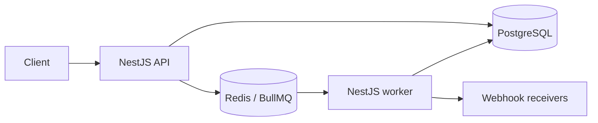

# Resolve API

[](https://github.com/abdu2030/Resolve_api/actions/workflows/ci.yml)

Resolve API links Person and Company records from systems like CRM, billing, and CSV imports to canonical entities. It preserves the original records and shows the evidence behind each match, where each canonical value came from, and how decisions changed over time.

- **Match records across sources.** Normalize fields, find candidates within the tenant, and score matches with versioned rules.
- **Review uncertain matches.** Inspect the evidence, approve or reject a proposed link, and reverse mistaken merges.
- **Integrate through one REST API.** Use scoped API keys, idempotent ingestion, asynchronous batches, and signed webhooks with retry and replay support.

## Quickstart

Install Git and Docker with the Compose plugin. The API and worker build inside Docker. Install Node.js 24 or later on your machine to run the client scripts.

```bash
git clone https://github.com/abdu2030/Resolve_api.git
cd Resolve_api
```

In a fresh checkout, copy `.env.example` to `.env` with `cp .env.example .env` on macOS or Linux, or `Copy-Item .env.example .env` in PowerShell. Start the stack from the repository root.

```bash
docker compose up --build --wait
docker compose ps --all
```

Compose applies the committed PostgreSQL migrations before starting the API and worker. Look for the `migrate` service to show `Exited (0)` and the API to show `healthy`.

| Local endpoint                                  | Use                                              |
| ----------------------------------------------- | ------------------------------------------------ |
| [Swagger UI](http://localhost:3000/docs)        | Browse and try API operations                    |
| [OpenAPI JSON](http://localhost:3000/docs-json) | Download the generated contract                  |
| [Readiness](http://localhost:3000/health/ready) | Check the API's PostgreSQL and Redis connections |
| [Liveness](http://localhost:3000/health/live)   | Check that the API process responds              |

Use `docker compose down` to stop the stack and keep the database and Redis volumes. For host development or custom ports, see the [setup guide](docs/getting-started.md).

## Try the API

Create a local demo tenant with a key scoped to the operations the client uses. The command prints the secret once.

```bash
docker compose exec -T api node apps/api/dist/auth/bootstrap-api-key.js --tenant-name "Local demo" --environment test --scopes sources:write,records:write,jobs:read,entities:read
```

Enter the key at the prompt. The client uses `http://127.0.0.1:3000` by default. Set `RESOLVE_BASE_URL` if you changed the host port.

**Bash**

```bash
read -rsp 'Resolve API key: ' RESOLVE_API_KEY
printf '\n'
export RESOLVE_API_KEY
node examples/resolve-client.mjs
```

**PowerShell 7**

```powershell
$env:RESOLVE_API_KEY = Read-Host -MaskInput 'Resolve API key'
node examples/resolve-client.mjs
```

Expect `NO_MATCH` for the first record, a successful idempotent replay, and `AUTO_MATCH` for the second source record after the batch completes. Both records link to the same canonical entity.

The [full two-tenant demo](docs/testing/week3-day7-mvp-demo.md) adds review approval, merge reversal, provenance checks, and cross-tenant access denials using synthetic CRM and billing records.

## How resolution works

Resolve stores the source payload, normalizes comparable fields, and uses indexed lookups to find a bounded set of candidates in the authenticated tenant. Each decision includes a confidence score, structured evidence, and an algorithm version.

| Decision     | Result                                                        |
| ------------ | ------------------------------------------------------------- |
| `AUTO_MATCH` | Link the incoming record to an existing entity.               |
| `REVIEW`     | Open a review case with the proposed entity and its evidence. |
| `NO_MATCH`   | Create a canonical entity and link the incoming record to it. |

Canonical fields retain their source provenance and version history. Use the history and linked-record endpoints to inspect why a value was selected or how the entity changed.

### API at a glance

| Task                                  | Endpoint                                                                     |
| ------------------------------------- | ---------------------------------------------------------------------------- |
| Register a source system              | `POST /v1/sources`                                                           |
| Resolve one record                    | `POST /v1/records`                                                           |
| Submit a batch of up to 100 records   | `POST /v1/records/batch`                                                     |
| Read a batch job                      | `GET /v1/jobs/{jobId}`                                                       |
| Read an entity and its provenance     | `GET /v1/entities/{entityId}`                                                |
| Read linked records or entity history | `GET /v1/entities/{entityId}/records`, `GET /v1/entities/{entityId}/history` |
| List reviews or submit a decision     | `GET /v1/reviews`, `POST /v1/reviews/{reviewId}/decision`                    |
| Merge or split an entity              | `POST /v1/entities/{entityId}/merge`, `POST /v1/entities/{entityId}/split`   |
| Register a webhook endpoint           | `POST /v1/webhook-endpoints`                                                 |

Protected routes use `Authorization: Bearer <api-key>`. Check the route's scopes, idempotency requirements, and response schema in the [v1 API contract](docs/contracts/mvp-v1.md).

## Architecture

Resolve is a TypeScript modular monolith with a NestJS API and a separate worker process. PostgreSQL stores records, evidence, and audit history through Prisma. Redis backs BullMQ for batch jobs and webhook delivery and supplies shared rate-limit counters.



| Path           | Contents                                                                      |
| -------------- | ----------------------------------------------------------------------------- |
| `apps/api/`    | REST endpoints, authentication, and resolution workflows                      |
| `apps/worker/` | Batch processing and webhook delivery                                         |
| `packages/`    | Shared contracts, configuration, normalization, matching, and database access |
| `tests/`       | Integration tests, fixtures, and the labeled golden dataset                   |
| `examples/`    | Runnable Node.js clients and synthetic demo data                              |

See the [architecture overview](docs/architecture/overview.md) for module boundaries and matching policy.

## Development and testing

Use the variables in [`.env.example`](.env.example) for local development. `DATABASE_URL`, `REDIS_HOST`, and `REDIS_PORT` configure the host-run application. `TEST_DATABASE_URL` can point integration tests at a dedicated PostgreSQL database.

With the local `.env` in place, install dependencies and start the test services. In Windows PowerShell, use `npm.cmd` if your execution policy blocks `npm`.

```bash
npm ci
docker compose up -d --wait postgres redis
npm run prisma:generate
npm run format:check
npm run lint
npm run typecheck
npm run build
npm test
npm run test:integration
```

Run `npm run evaluate:golden` to measure matching against eight labeled synthetic pairs. The recorded baseline is **3/3 automatic-match precision** and **3/5 automatic-match recall**. One same-identity pair went to review and one was missed during candidate lookup. [Evaluation method and results](docs/testing/week2-day7-quality-powershell.md)

## Deployment and further reading

- Configure private HTTPS access, run migrations, and rehearse a PostgreSQL and Redis restore. [Staging runbook](docs/staging.md)
- Inspect canonical field selection, source history, and access checks in PowerShell. [Canonicalization walkthrough](docs/testing/canonicalization-powershell.md)
- Reproduce the security and performance checks. [Security and performance baseline](docs/testing/week3-day5-security-performance-powershell.md)
- Review repository conventions before contributing changes. [Engineering rules](AGENTS.md)
